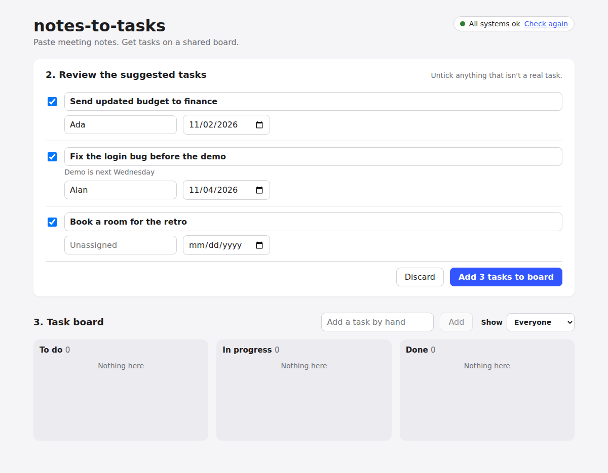
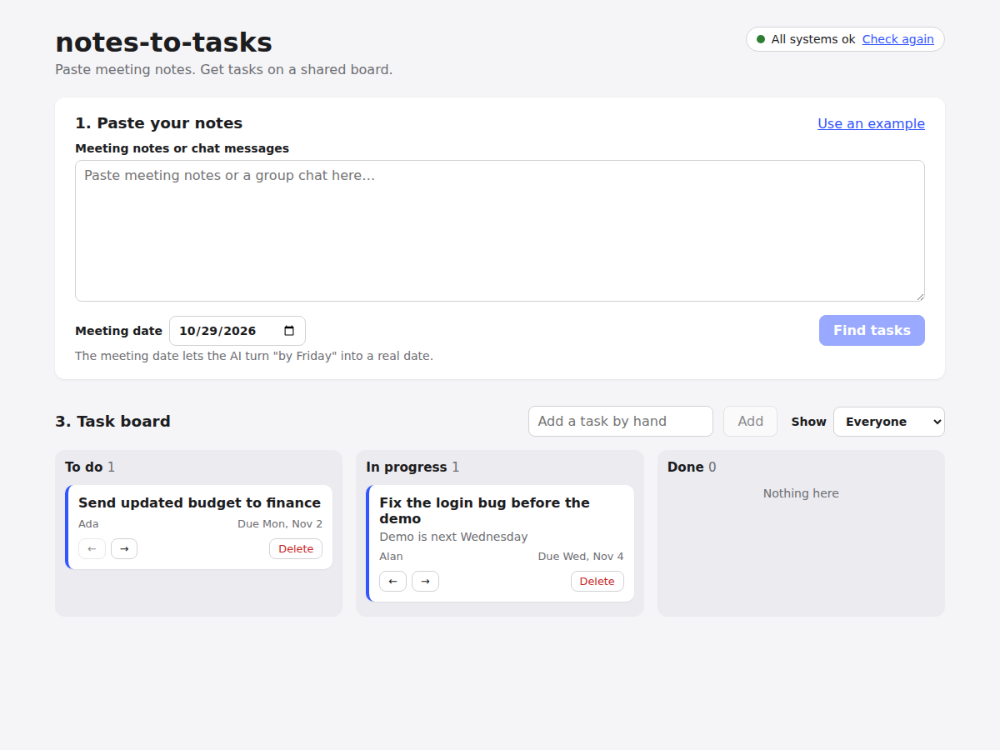

# notes-to-tasks

[](https://github.com/HachemChamas/notes-to-tasks/actions/workflows/ci.yml)

Paste meeting notes or a group chat. An AI agent finds the tasks, with owners
and due dates. You review and approve them, and they appear on a shared task
board.




## Features

- **AI task extraction.** Claude reads the notes and returns tasks as validated
  JSON (structured outputs), so the app never has to parse free text.
- **Real due dates.** "By Friday" becomes `2026-11-06`, worked out from the
  meeting date you enter.
- **Human in the loop.** Nothing reaches the board until you approve it. You
  can edit titles, owners and dates, or untick suggestions you don't want.
- **Shared board.** To do / In progress / Done columns, filter by person,
  overdue highlighting, and tasks added by hand. The board refreshes every
  15 seconds, so teammates see each other's changes.
- **Owner matching.** "ada" and "Ada" become the same person, and the AI is
  told who is already on the team.
- **Tested and CI'd.** 23 backend and 16 frontend tests, plus a GitHub
  Actions pipeline that also checks the migrations against real Postgres.

## Tech stack

| Layer | Tools |
| --- | --- |
| Frontend | React 19, Vite, Vitest, React Testing Library |
| Backend | Python, FastAPI, SQLAlchemy 2, Alembic, Pydantic |
| Database | PostgreSQL 16 (Docker) |
| AI | Claude API through the official `anthropic` Python SDK |
| CI | GitHub Actions |

## How it works

```
Browser (React, :5173)  --HTTP-->  FastAPI (:8000)  --SQL-->  Postgres (:5432)
                                         |
                                         +--HTTPS-->  Claude API
```

1. **`POST /extract`.** The backend saves the note, then sends Claude the
   text, the meeting date and the team's names, asking for JSON that matches a
   Pydantic schema. The answer is cleaned up (blank titles dropped,
   unreadable dates removed) and returned as *suggestions*.
2. **Review.** The frontend shows the suggestions in an editable list.
3. **`POST /tasks/bulk`.** The approved tasks are saved in one transaction.
   Owners are found by name, or added.
4. **Board.** `GET /tasks` and `PATCH /tasks/{id}` move cards between columns.

A few design decisions:

- **The AI is behind a FastAPI dependency** (`get_extractor`), so the tests
  swap in a fake and never need network access or an API key.
- **Errors are translated.** A rate limit, a bad key, or the model declining
  each become a clear message in the UI, not a stack trace.
- **Notes are treated as data.** The system prompt tells the model to ignore
  instructions inside the pasted text (basic prompt-injection hygiene).

## API

Interactive docs are at http://localhost:8000/docs while the backend runs.

| Method | Path | What it does |
| --- | --- | --- |
| GET | `/health` | API and database status |
| POST | `/extract` | Notes in, suggested tasks out (not saved as tasks) |
| GET | `/tasks` | List tasks. Optional `?status=` and `?owner_id=` |
| POST | `/tasks` | Add one task |
| POST | `/tasks/bulk` | Save approved tasks |
| PATCH | `/tasks/{id}` | Change some fields (status, owner, date…) |
| DELETE | `/tasks/{id}` | Delete a task |
| GET / POST | `/users` | List or add people |

---

## Running it locally, step by step

### 0. Install the tools (one time)

| Tool | Version | Check with |
| --- | --- | --- |
| [Git](https://git-scm.com/) | any recent | `git --version` |
| [Docker Desktop](https://www.docker.com/products/docker-desktop/) | any recent | `docker compose version` |
| [Python](https://www.python.org/downloads/) | 3.11 or newer | `python3 --version` (Windows: `python --version`) |
| [Node.js](https://nodejs.org/) | 24 LTS | `node --version` |

You also need a **Claude API key** from https://platform.claude.com
(Settings → API keys) for the extraction step. Everything else, including
all the tests, works without one.

### 1. Get the code and create your `.env`

```bash
git clone https://github.com/HachemChamas/notes-to-tasks.git
cd notes-to-tasks
cp .env.example .env
```

(Windows PowerShell: `Copy-Item .env.example .env`)

Open `.env` and:
- change `POSTGRES_PASSWORD`, and put the **same** password inside `DATABASE_URL`
- paste your key after `ANTHROPIC_API_KEY=`

`.env` is ignored by Git, so your password and key never get committed.

### 2. Start Postgres

```bash
docker compose up -d
docker compose ps        # STATUS should say "healthy" after a few seconds
```

### 3. Start the backend

```bash
cd backend
python3 -m venv .venv
source .venv/bin/activate          # Windows PowerShell: .venv\Scripts\Activate.ps1
pip install -r requirements.txt
alembic upgrade head               # create the tables
uvicorn app.main:app --reload      # --reload restarts on every save
```

Check it: http://localhost:8000/health should show
`{"status": "ok", "database": "ok"}`.

### 4. Start the frontend

In a **second** terminal:

```bash
cd frontend
npm install
npm run dev
```

### 5. Use it

Open http://localhost:5173, click **Use an example**, then **Find tasks**.

### Stopping everything

- Backend and frontend: `Ctrl+C` in their terminals.
- Postgres: `docker compose down` (data is kept), or `docker compose down -v` to delete it.

---

## Running the tests

The tests need no Docker, no running servers and no API key. The backend
uses an in-memory SQLite database and a fake AI; the frontend fakes the API.

```bash
cd backend && pytest        # with the virtual environment activated
cd frontend && npm test
```

## Project layout

```
notes-to-tasks/
├── .env.example              # every setting, with safe example values
├── docker-compose.yml        # Postgres
├── .github/workflows/ci.yml  # tests + migration check on every push
├── backend/
│   ├── app/
│   │   ├── main.py           # creates the app, CORS, /health
│   │   ├── config.py         # reads settings from .env
│   │   ├── database.py       # Postgres connection and sessions
│   │   ├── models.py         # tables: users, notes, tasks
│   │   ├── schemas.py        # JSON shapes the API accepts and returns
│   │   ├── extractor.py      # the Claude call: prompt, schema, error handling
│   │   └── routers/          # endpoints: extract.py, tasks.py, users.py
│   ├── alembic/versions/     # migrations 0001 and 0002
│   └── tests/
└── frontend/src/
    ├── App.jsx               # owns the data, wires the steps together
    ├── api.js                # every call to the backend
    ├── dates.js              # date formatting and "overdue"
    └── components/           # HealthBadge, NotesForm, ReviewPanel, TaskBoard, TaskCard
```

## Database migrations

```bash
alembic upgrade head                      # apply all new migrations
alembic downgrade -1                      # undo the last one
alembic revision -m "add comments table"  # create a new migration file
```

When you change `app/models.py`, write a migration that makes the same change.
`alembic check` (also run in CI) fails if the two disagree.

## Troubleshooting

**`RuntimeError: DATABASE_URL is not set`**
There is no `.env` file in the repo root. Do step 1 again.

**"No Claude API key is set" when finding tasks**
Put your key in `.env` as `ANTHROPIC_API_KEY=...` and restart the backend.

**`/health` says `"database": "unavailable"`**
Postgres isn't running, or `DATABASE_URL` doesn't match the `POSTGRES_*`
values. Run `docker compose ps` and compare. The backend terminal prints the
exact error.

**`port is already allocated` on 5432**
Set `POSTGRES_PORT=5433` in `.env`, change the port in `DATABASE_URL` to
`5433` too, and run `docker compose up -d` again.

**Changed the password in `.env` but Postgres still uses the old one?**
Postgres only reads it when it first creates its data. Run
`docker compose down -v` (deletes the data), then `docker compose up -d`.

**The page says "Could not reach the backend"**
The backend isn't running, or `VITE_API_URL` is wrong. Restart `npm run dev`
after changing `.env`.

**CORS error in the browser console**
`FRONTEND_ORIGIN` must exactly match the address in your address bar.
Restart the backend after changing it.

## Ideas for next steps

- Log in with accounts, and keep separate boards per team
- Push updates over WebSockets instead of refreshing every 15 seconds
- Drag and drop between columns
- Deploy it (for example the backend on Render or Fly.io, the frontend on Vercel)
